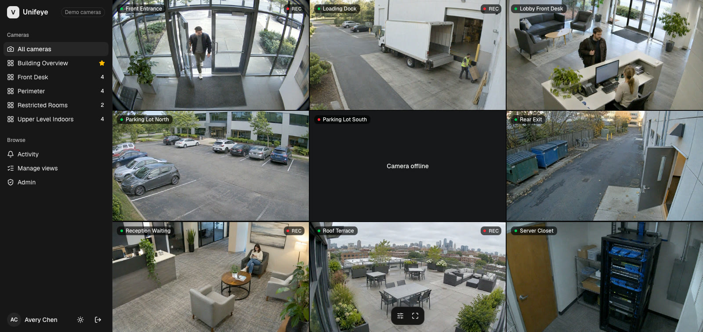
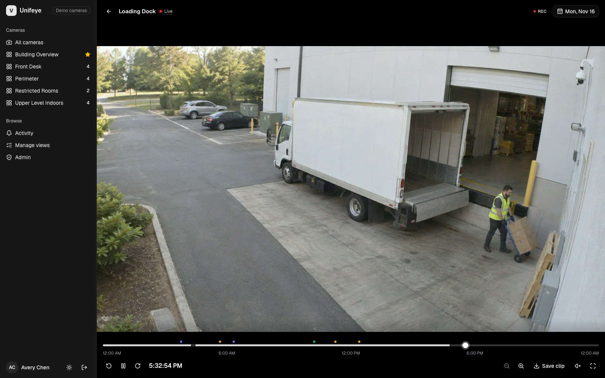
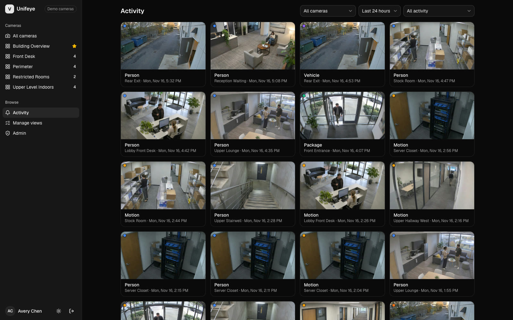
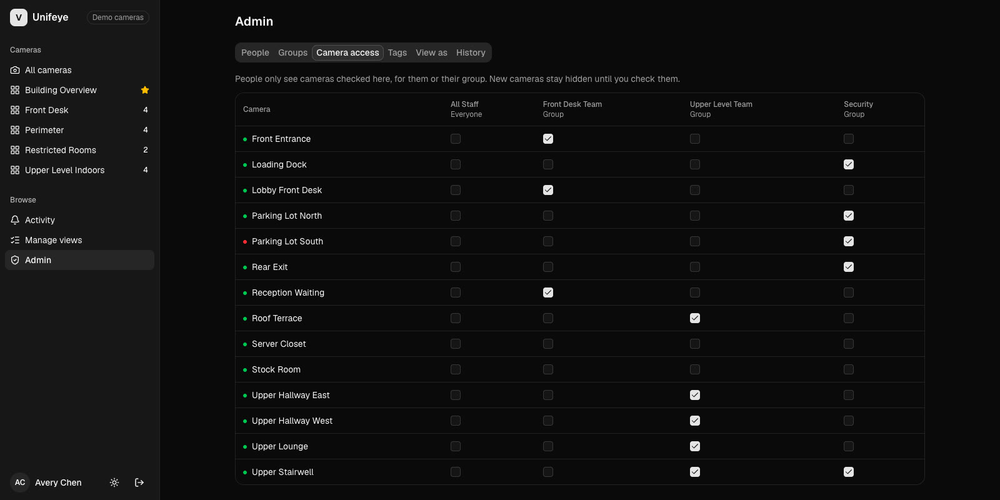
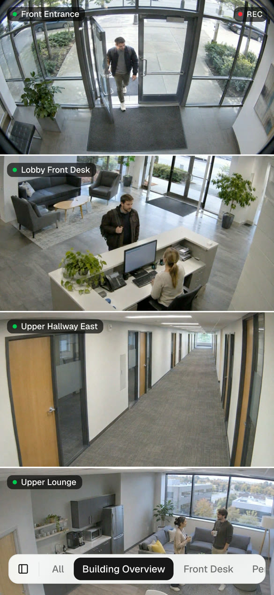

# Unifeye

A read-only viewer for UniFi Protect cameras. Administrators decide who sees which camera, tag
cameras and build shared views. Everyone else signs in and sees only the cameras they were given.

People sign in one of three ways, set with `SIGN_IN_METHODS`:

- **Company sign-in.** Any OpenID Connect provider, such as Microsoft Entra ID, Google Workspace,
  Keycloak or Zitadel. This is the default.
- **Cloudflare Access.** For when Access already sits in front of Unifeye.
- **Password accounts.** An administrator creates the account and hands out a one-time link to set
  the password. Off unless you turn it on.

Unifeye never writes to the recorder. It doesn't change camera settings, recordings, events or
Protect users.



<table>
  <tr>
    <td width="50%"></td>
    <td width="50%"></td>
  </tr>
  <tr>
    <td><b>One camera.</b> Live or recorded, with the day's timeline. Save a clip of any stretch.</td>
    <td><b>Activity.</b> People, vehicles, packages and motion, only from cameras you may see.</td>
  </tr>
  <tr>
    <td width="50%"></td>
    <td width="50%" align="center"></td>
  </tr>
  <tr>
    <td><b>Camera access.</b> A new camera is hidden from everyone until an administrator grants it.</td>
    <td><b>On a phone.</b> The same views, in light or dark.</td>
  </tr>
</table>

<sub>The screenshots show simulated cameras with AI-generated stills from <code>assets/demo-cameras/</code>. No real footage. Retake them with <code>scripts/screenshots/capture.sh</code>.</sub>

Built with Next.js 16, React 19, shadcn/ui, SQLite with Drizzle, and MediaMTX for live video. It
ships as one Docker Compose stack.

## Status

Unifeye runs in production with Docker Compose, against a UNVR on Protect 7.3.74 with 42 cameras,
signing people in through Zitadel, behind Cloudflare Tunnel. The automated tests cover permissions,
views, all three sign-in methods, media access, migrations and backups, using a simulated recorder
and stubbed sign-in services.

Still unchecked: other identity providers, a real Cloudflare Access team, password accounts in a
browser, and other Protect versions. [docs/verification.md](docs/verification.md)
lists exactly what has been checked and what hasn't.

## Install

The easiest way is to let an AI coding agent (Claude Code, Codex and the like) do it over SSH. Tell
it:

> Follow LLM/INSTALL.md from github.com/cmer/unifeye and install it on 192.168.1.50.

Use your server's address. The agent asks you questions as it goes and tells you the few steps only
you can do, like setting up sign-in, the recorder account and your router.

To install by hand, follow [docs/deployment.md](docs/deployment.md). To update a running install
later, run `scripts/update.sh` on the server.

## Run it locally

You need Node.js 22.20 or newer, pnpm, FFmpeg, and a MediaMTX 1.21.4 binary for live video. The
cameras are simulated.

```sh
pnpm install
cp .env.development.example .env.development.local

pnpm dev:idp        # terminal 1: test sign-in provider on :9911 (development only)
pnpm dev            # terminal 2: the app on http://localhost:3000

# terminal 3, for live video
MTX_AUTHHTTPADDRESS="http://127.0.0.1:3001/mediamtx-auth?secret=dev-hook" \
MTX_WEBRTCADDITIONALHOSTS=127.0.0.1 mediamtx docker/mediamtx.yml
```

Open http://localhost:3000 and pick "Avery Chen", the first administrator. That first sign-in
creates demo tags, groups and views. The other test people start with no cameras until you add
them to a group in Admin.

Two optional lines in `.env.development.local`:

- `MOCK_PHOTOS=assets/demo-cameras` shows the AI-generated camera stills from the screenshots
  instead of colour gradients.
- `SIGN_IN_METHODS=oidc,local` turns on password accounts. Create one with
  `pnpm unifeye create-admin <username>`.

## Commands

| Task | Command |
| --- | --- |
| Develop | `pnpm dev` |
| Test | `pnpm test` |
| Type-check, lint | `pnpm typecheck`, `pnpm lint` |
| Production build | `pnpm build` |
| New migration after a schema change | `pnpm db:generate` |
| Apply migrations | `pnpm unifeye migrate` |
| Back up, check a backup, restore | `pnpm unifeye backup`, `verify <file>`, `restore <file> [--force]` |
| List people with their sign-in identity | `pnpm unifeye users` |
| Create a password administrator | `pnpm unifeye create-admin <username> [name]` |
| New password link | `pnpm unifeye password-link <username>` |

Inside the Docker container, run the same commands as `node cli.mjs <command>`, for example
`docker compose exec app node cli.mjs backup`.

## Docs

- [docs/deployment.md](docs/deployment.md): where to run it, choosing sign-in methods,
  configuration, networking, backups, restore and upgrades.
- [docs/identity-providers.md](docs/identity-providers.md): sign-in setup for Zitadel, Keycloak,
  Microsoft Entra ID and Google Workspace.
- [docs/cloudflare-tunnel.md](docs/cloudflare-tunnel.md): running behind Cloudflare Tunnel, and what
  that means for live video.
- [docs/architecture.md](docs/architecture.md): how it works, including the permission model, views,
  sign-in and how video access is enforced.
- [docs/verification.md](docs/verification.md): what has been tested, on which versions, and how to
  check a real recorder and sign-in provider.
- [LLM/INSTALL.md](LLM/INSTALL.md): the install guide for AI agents.
- [prototype/protect-viewer-mockup.html](prototype/protect-viewer-mockup.html): the original
  clickable prototype. Open it in a browser. Everything in it is simulated.

## License

[MIT](LICENSE)
