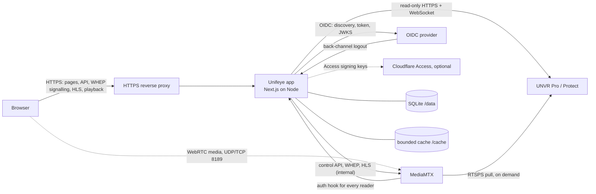

# Architecture

## Components and data flow

Only the reverse proxy and MediaMTX's WebRTC media port face the network. MediaMTX's API, WHEP,
HLS and RTSP listeners are internal. Protect credentials and RTSPS URLs never leave the server.

| Data | Owner | What Unifeye does |
| --- | --- | --- |
| Cameras, names, capabilities, live video, recordings, events | UniFi Protect | Reads and relays. Stores only a stable reference `(nvr id, Protect camera id)` and a disposable metadata cache. |
| Identity, credentials, MFA, recovery | OIDC provider or Cloudflare Access | Verifies what they assert. |
| Password accounts (only with `local` on) | Unifeye (SQLite) | Usernames, scrypt hashes, one-time password links. |
| Profiles, roles, groups, tags, grants, views, sharing, defaults, sessions, preferences, audit | Unifeye (SQLite) | Authoritative. |

No video, snapshot or recording is stored in SQLite. Playback windows and clips live in a
size- and age-bounded directory.

## Code map

| Path | Purpose |
| --- | --- |
| `src/server/authz/policy.ts` | The one place that decides who may see which camera. |
| `src/server/authz/access.ts` | Standing access: whether access already handed out still holds, and the signal to re-check it. |
| `src/server/authz/views.ts` | Saved views, sanitized resolution, landing precedence. |
| `src/server/authz/preview.ts` | "See as staff". |
| `src/server/admin.ts` | Every change to Unifeye data: validation, transaction, audit, cache invalidation. |
| `src/server/auth/` | Sign-in (`oidc.ts`, `local.ts`, `cloudflare.ts`, shared `provision.ts`), sessions, back-channel logout, lifecycle re-validation. |
| `src/server/protect/` | Adapter contract, the real `unifi-protect` adapter, the mock adapter. |
| `src/server/media/` | Media gateway and revocation sweep (`gateway.ts`), the relay interface (`relay.ts`) and its MediaMTX adapter (`mediamtx.ts`), playback windows, clip export. |
| `src/server/testing/` | Test fixture and the in-memory relay used by the automated tests. |
| `src/server/api.ts` | All HTTP endpoints, authentication, CSRF, rate limits. |
| `src/ui/` | The React interface. |
| `drizzle/` | Versioned SQL migrations. |

## Camera permissions

- Deny by default. A new or disabled user sees nothing.
- Staff see the union of cameras granted to them directly and to any group they belong to,
  including the built-in "All Staff" group. Grants are allow-only; there are no deny rules.
- Administrators see every camera through an explicit rule in the policy.
- Tags and view sharing never grant a camera.
- A newly discovered camera has no grants, so only administrators see it.
- A forbidden camera returns exactly what a non-existent one does (404), on every route.

| Capability | Admin | Staff |
| --- | --- | --- |
| Cameras and media | All | Granted cameras only |
| See which cameras are recording right now (REC mark) | Yes, but not while previewing as staff | No |
| Open views | All curated views and their own | Their own private views and views shared with them |
| Create private views | Yes | When an administrator allows it |
| Create, edit and share curated views | Yes | No |
| Set other people's starting view | Yes | No |
| Tags, people, groups, grants | Yes | No |
| See as staff | Yes | No |
| Change Protect | No | No |

The policy caches results in memory and drops the cache on every change to users, groups, grants
or the camera inventory.

## Standing access

The policy answers for one moment. Live streams, WHEP resources, clip downloads and the event feed
outlive the request that authorized them, so each keeps a small grant record: session, effective
subject, preview (when made during "See as staff") and camera (none for the event feed). Clip
exports store theirs in `export_jobs`; the others keep it in memory.

`Access` (`src/server/authz/access.ts`) is the only place that decides whether a grant still holds:

- the session is live: not revoked, inside its idle and absolute limits, its user active, and
  re-validated with the provider recently enough;
- the preview, if there was one, is live: not ended or timed out, the administrator still an
  administrator, the subject still active staff;
- the subject can still see the camera according to the policy.

Anything that cannot be resolved denies. A grant can only be used by the session and subject it
was made for.

`Access` also owns the one "access may have changed" signal. It fires on:

| Source | When |
| --- | --- |
| Policy | Any cache invalidation: a change to users, roles, groups, memberships, grants, tags or views, or a camera appearing, going missing or returning. |
| Sessions | A session is revoked, replaced at sign-in, or found past its idle or absolute limit. |
| Previews | A preview is exited, times out, or its administrator or subject stops qualifying. |

Time limits pass without an event, so a timer (`REVOCATION_SWEEP_SECONDS`) records due session and
preview expiries, which fires the signal, and sweeps the relay regardless. The camera sync runs
every 30 seconds and signals only when the inventory changed; a new name or recorder metadata
refreshes the description cache without a signal, because neither is an input to any decision.
The inventory holds only cameras adopted by this recorder: one Protect merely sees on the network, or
one adopted by another NVR, is left out, so a camera that is un-adopted goes missing like a removed
one. Missing cameras keep their grants, tags and view slots but are hidden from the camera wall;
administrators still see them, marked removed, in the access matrix and view editor.

A session suspended because the provider could not be reached is not ended and produces no signal. Its
requests fail at once and the timer's relay sweep stops its streams; an open event feed closes at
the next event or signal.

Three holders subscribe. The relay and clip exports are wired in `buildServices`
(`src/server/services.ts`); the event feed subscribes per open connection.

| Holder | On the signal |
| --- | --- |
| Media gateway | Sweeps: kicks relay readers and drops WHEP and HLS state whose grant no longer holds. |
| Clip exports | Aborts and deletes jobs and files whose grant no longer holds. |
| Event feed | Closes the connection if its session or preview is gone. Cameras are filtered per event. |

## Views

- **Follows tags (dynamic):** stores tag IDs in `view_predicate_tags`. A camera matches when it has
  every tag. Membership is recomputed on each request, sorted by name then ID.
- **Fixed list (static):** stores camera IDs and positions in `view_cameras`. Tags do not affect it.

The two kinds are stored separately and converting between them is an explicit, confirmed action.
A tag used by a view cannot be deleted until it is removed from that view.

What anyone sees is `view selection ∩ their camera grants`, computed every time. Staff receive a
sanitized view: no IDs, names or counts for cameras they cannot see. Sharing with a person and a
group at once lists the view once; removing one share keeps access if another remains.

### Starting view

The first match the person can still open wins:

1. A view an administrator picked for that person.
2. A view picked for one of their groups: highest `default_priority`, ties to the lower group ID.
3. The person's own choice, if personal views are enabled for them.
4. The view for everyone.
5. All their cameras, or a "no cameras yet" message.

Assignments are validated when set (the target must be able to open the view) and again at every
sign-in. A deleted or unshared default is skipped. A default that resolves to zero cameras opens
empty with a way to other views; nothing is borrowed to fill it.

## Sign-in and sessions

`SIGN_IN_METHODS` turns on any of three ways in. `oidc` and `cloudflare` cannot be combined.

| Method | Who proves identity | Identity `(issuer, subject)` | Who creates the profile |
| --- | --- | --- | --- |
| `oidc` (default) | The identity provider | Provider issuer, ID token `sub` | First admitted sign-in |
| `cloudflare` | Cloudflare Access | `https://<team>.cloudflareaccess.com`, Access token `sub` | First request through Access |
| `local` | Unifeye (password) | `unifeye:local`, the profile's own id | An administrator, or `unifeye create-admin` |

Rules that hold for all of them:

- Each profile records its method (`users.auth_method`), fixed when it is created. A profile is
  only ever matched for its own method, so two methods can never share or take over a profile, even
  with the same issuer and subject. Nothing links profiles across methods, by email or otherwise;
  the same human with a work account and a password account is two people.
- `Policy.activeUser` treats a person whose method is turned off as inactive. Every session, grant,
  preview and admin check goes through it, so removing a method from `SIGN_IN_METHODS` locks its
  people out everywhere on the next request, and their media stops at the next sweep.
- A sign-in always creates a new session and revokes the one the browser held before.
- Signed-out browsers go to `GET /api/auth/login`, which picks the way in: Cloudflare (when the
  request carries an Access token), straight to the identity provider (when it is the only method
  besides Cloudflare), or the `/sign-in` page (when passwords are on; it also offers the provider).

### Rate limits

Fixed one-minute windows in `src/server/api.ts`. Signed-in requests count per session, so people
behind one address (an office, a VPN) do not share a limit. Sign-in routes, and requests to
signed-in routes that fail to authenticate (`unauth`, such as a wall left open after signing out),
count per client address; a valid session is never refused because of its address.

| Class | Per minute | Counted per |
| --- | --- | --- |
| `auth` (sign-in routes) | 30 | address |
| `unauth` (failed authentication) | 600 | address |
| `read` / `write` | 1,200 / 240 | session |
| `media` (snapshots, WebRTC set-up, playback, thumbnails, exports) | 600 | session |
| `hls` (playlists and segments) | 120 × (`MAX_WALL_STREAMS` + 3), 1,440 by default | session |

An HLS stream on Protect cameras polls a video and a sound playlist and fetches a segment of each
every 4 seconds, about 60 requests a minute (measured 2026-11-17: 29 playlist requests per tile per
minute in Chrome). HLS has its own budget, sized from the stream limit, so a full wall on HLS
fits beside its still-image refreshes.

The client address is the last `X-Forwarded-For` entry: the one the nearest proxy appends. Earlier
entries are whatever the client sent. Next fills the header from the connection when a request
arrives without one, so a client that reaches Unifeye directly, with no proxy, can still choose it.

### Company sign-in (`oidc`)

- Authorization Code with PKCE (S256), state and nonce, in a single-use transaction that expires in
  ten minutes. The code is exchanged on the server.
- The ID token is checked by `openid-client` and its signature is verified again explicitly against
  the issuer's JWKS, because the library skips the signature check for tokens that arrive directly
  from the token endpoint.
- Admission: the ID token claim named by `OIDC_ADMIT_CLAIM` must carry one of
  `OIDC_ADMIT_VALUES` (or just be non-empty when no values are listed). Production requires a
  claim unless `OIDC_ADMIT_ANY` is set.
- Identity is the exact `(issuer, subject)` pair. Email is a display attribute and is never used to
  find or link a profile.
- First sign-in creates a profile with no cameras and no administrator rights.
- Group sync: when a group lists values for the group claim (`OIDC_GROUPS_CLAIM`, default
  `OIDC_ADMIT_CLAIM`), people whose ID token carries one of them are added to it. These memberships
  are marked `provider` and are removed when the value goes away, checked at sign-in and on every
  refresh-token re-check (only from an ID token verified against the issuer's keys for the same
  subject). Manual memberships are never removed by the sync. The values last seen for each person
  are stored, so a mapping change applies immediately.
- The first administrator is the `(issuer, subject)` named in deployment configuration, promoted
  once on a normal sign-in, and audited.
- Sessions are random opaque tokens, stored hashed, in an HttpOnly cookie (Secure over HTTPS,
  SameSite=Lax), rotated at every sign-in, with idle and absolute limits. Writes need a per-session
  CSRF token and a same-origin request.
- Provider tokens are encrypted with `TOKEN_ENC_KEY` (AES-256-GCM). Only the ID token (for logout)
  and a refresh token (for re-validation) are kept.

### Password accounts (`local`)

- Only administrators create them (`POST /api/admin/users`, through `Admin`), plus the operator
  from the command line (`unifeye create-admin`, `unifeye password-link`). There is no sign-up and
  no email.
- An account starts with no password. Creating it returns a one-time link to
  `/set-password#<secret>`, valid 24 hours. Only the SHA-256 of the secret is stored, the secret sits
  in the URL fragment so it never reaches server or proxy logs, and the page removes it from the
  address bar. Making a new link invalidates earlier unused ones. A link is consumed inside the write
  transaction that sets the password, so it works exactly once. Using a link ends all of the person's
  sessions. A forgotten password is the same flow: an administrator makes a new link. The current
  password keeps working until the link is used.
- Links point at `LOCAL_APP_URL` when set (the address these people use), otherwise `APP_URL`.
- Passwords: at least 10 characters, at most 200, not a well-known password, not containing the
  username. No composition rules. Stored as `scrypt$N$r$p$salt$hash` with N=2^15, r=8, p=3 (32 MB,
  one of OWASP's equivalent settings) and a 16-byte salt; verified with a constant-time compare. Two
  checks run at a time (libuv's four worker threads are shared with file I/O), up to twenty more
  wait in line, and beyond that a sign-in is refused with "try again in a moment" before it is
  counted.
- Sign-in (`POST /api/auth/password`) gives the same answer, after the same scrypt work, for an
  unknown username, a wrong password and an account with no password yet. Each username (real or
  not) is locked after five failed tries, for 30 seconds doubling to 15 minutes; the count is taken
  before the slow check so parallel guesses cannot slip past it. Counts are in memory, forgotten
  after 30 quiet minutes, and at most 100,000 usernames are tracked; when full, the oldest idle
  entries go first and a running lock is never dropped, so flooding junk usernames cannot clear one.
  Every lock is audited. The per-address sign-in rate limit also applies. A correct password for
  a disabled account says so.
- Password routes take small JSON bodies only (a `Content-Length` of at most 4 KB).
- Return addresses (`returnTo`) must be same-site paths in printable ASCII: no `//`, backslashes,
  spaces or control characters (URL parsers drop tabs and newlines), and they must resolve to the
  same origin.
- The password routes exist only while `local` is on. They carry no session, so instead of the
  CSRF token they require a JSON body and an `Origin` naming `APP_URL` or `LOCAL_APP_URL`.
- People change their own password with the current one (`POST /api/me/password`, CSRF as usual);
  their other sessions end and any unused password link is cancelled. Wrong guesses there have
  their own lock, so they cannot lock the person out of signing in. Not available while previewing.
- Password accounts have no admission claim and no group sync. Groups are manual.

### Cloudflare Access (`cloudflare`)

- Access sits in front of Unifeye and adds `Cf-Access-Jwt-Assertion` to every request it lets
  through. Unifeye verifies it on every request: RS256 against
  `https://<team>/cdn-cgi/access/certs`, issuer `https://<team>`, audience in `CF_ACCESS_AUD`, not
  expired, and a non-empty `sub` (service tokens have none and are refused). The `CF_Authorization`
  cookie is never read.
- A valid Access token does not prove the request came through Cloudflare: its holder can attach it
  to a request sent straight to the server, for example from the local network, and keep using it
  after Cloudflare has revoked them until the token expires. So Cloudflare also adds a secret
  request header at its edge (a Transform Rule setting `X-Unifeye-Origin-Secret` to
  `CF_ACCESS_ORIGIN_SECRET`). When the secret is configured, which is required alongside `local`, a
  request carrying an Access token but not the secret is refused outright (`forged`), never treated
  as local. So is a request carrying the secret header without an Access token: Cloudflare forwarded
  something Access did not cover, and that must not reach password sign-in from the internet.
- The request's path decides which identities it may carry:
  - With an Access token (and the secret) it came through Cloudflare. Only the session of exactly the identity in
    that token is accepted; a different identity, a password session or an invalid token is a 401.
    Password sign-in and password links are refused.
  - Without one it reached Unifeye some other way. A Cloudflare session is never accepted there.
    With `local` on, password sessions and password sign-in work, which is how local-network
    access is meant to be used; with `local` off, nothing works without the header.
- `GET /api/auth/login` with a valid token creates the session (and the profile on first use). An
  invalid token goes to the signed-out page; it never falls back to the password page.
- Revocation: Cloudflare stops forwarding requests for a person whose Access session ended or was
  revoked, but sends no notice. Every valid request refreshes the session's validation time, and a
  session not seen through Cloudflare for `CF_ACCESS_RECHECK_SECONDS` (default 300) is suspended,
  which stops its media at the next sweep. The app reloads `/me` every 30 seconds, so an open page
  keeps an active session fresh.
- Sign-out ends the Unifeye session and sends the browser to `/cdn-cgi/access/logout`.
- First administrator: sign in once, read the issuer and subject from `unifeye users`, set
  `BOOTSTRAP_ADMIN_ISSUER` and `BOOTSTRAP_ADMIN_SUBJECT`, restart and sign in again.

### How revocation reaches Unifeye

| Event | Mechanism | Delay until Unifeye knows |
| --- | --- | --- |
| Sign out in Unifeye | Session revoked directly | Immediate |
| Provider session ended or user signed out | Back-channel logout, if the provider sends it | The provider's delivery time |
| User disabled or deleted at the provider | Refresh-token check on a schedule; providers usually send no back-channel logout for these | Up to `OIDC_RECHECK_SECONDS` (default 5 minutes) |
| Access session ended or revoked in Cloudflare | No request carries a valid Access token any more; the session is suspended | Up to `CF_ACCESS_RECHECK_SECONDS` (default 5 minutes) |
| Password set from a link, or changed | Person's sessions revoked directly (all, or all but the current one) | Immediate |
| Sign-in method turned off | Its people are inactive in `Policy` (after the restart that applies the setting) | Immediate |
| Disabled in Unifeye, grant or group change | Policy invalidation | Immediate |
| "See as staff" exited or no longer allowed | Preview ended directly | Immediate |
| Session or preview time limit passes | Noticed by the next request, or by the timer | Up to `REVOCATION_SWEEP_SECONDS` |

Every row ends in the access signal described under [Standing access](#standing-access). Once
Unifeye knows, pages and API calls fail at once and playing media stops within
`REVOCATION_SWEEP_SECONDS` (default 10, maximum 30). Clip downloads and the event feed stop on the
same signal. If the provider is unreachable, no one can sign in,
existing sessions are not extended, and a session that could not be re-validated for
`OIDC_MAX_STALE_SECONDS` is suspended until the provider answers again.

## Media enforcement

1. The browser asks a Unifeye route for live video. The route authenticates the session, resolves
   the effective subject and checks the camera with the policy.
2. Unifeye calls MediaMTX itself with a random ticket bound to session, subject, camera, path and
   transport, valid for 30 seconds and single-use for WebRTC.
3. MediaMTX runs with `authMethod: http` and asks Unifeye's hook before serving any reader. A
   request without a valid ticket is refused even if it reaches MediaMTX directly. The only RTSP
   reader admitted is the relay's own FFmpeg (publisher credentials, internal address), and only on
   the internal `_src` paths described under Sound; no ticket ever names one of those.
4. Each admitted MediaMTX session is recorded with its grant. A sweep re-checks all of them with
   `Access` and kicks failures through the control API. It runs on every access signal and on a
   timer; a signal that arrives during a sweep triggers another one straight after. Readers Unifeye
   does not know about are kicked.
5. HLS is proxied entirely by Unifeye, so every playlist and segment request is authorized again.

WebRTC signalling is proxied; media flows from MediaMTX to the browser over ICE on port 8189
(`WEBRTC_PORT` in Compose). If no media arrives within 4 seconds, the player tears the WebRTC session
down and switches to HLS, and the tab skips WebRTC for 10 minutes (`src/ui/live.tsx`). Tearing down a WHEP session frees its slot at
once. The per-session limit (`MAX_WALL_STREAMS` + 3) counts distinct streams (camera and quality),
not relay readers, because HLS takes a new reader every 25 seconds.

### Sound

Video starts muted, and sound plays only after a viewer clicks the speaker (or presses M in the
player), so browsers' autoplay rules never block a stream. One camera plays sound at a time across
the wall and the player (`src/ui/sound.tsx`); turning one on turns the previous one off.

Whether the viewer wants sound is remembered in the browser (local storage): turning a speaker on
or off sets it. Opening a camera while it is on moves the sound to that camera, so a viewer turns
sound on once rather than for every stream; jumping around the timeline keeps it. If the browser
still refuses to play with sound (typically right after a reload, before any click), the video plays
muted and the sound comes back on the viewer's next click or key press. Only that refusal mutes; a
play interrupted by a seek does not.

Whether a stream has sound is decided in the browser once it plays:

- WebRTC: MediaMTX carries Opus, G.711 and LPCM, not AAC. For a stream without any of those it
  still answers with a placeholder audio track that never sends a packet, so sound counts only when
  packets arrive (the track unmutes). Still muted three seconds after connecting means no audio.
- HLS: the playlist's codecs (hls.js), or the browser's own report for native HLS.
- Recorded video: the browser's report for the MP4.

A camera without sound shows a greyed-out speaker that explains "No audio". While sound is on, a
small meter shows the level actually arriving, so a viewer can tell a quiet room from a problem with
their own speakers. The meter is missing where the browser cannot expose an element's audio
(Safari for HLS and recordings).

Protect stamps its live audio in milliseconds while declaring a 16 kHz (AAC) or 48 kHz (Opus)
clock, so its timestamps run 16 to 48 times too slow. Browsers play the first fraction of a second
and then discard nearly every packet as late: a moment of garbled sound, then silence. For a camera
with a microphone (`featureFlags.hasMic`), the relay therefore takes two paths (`mediamtx.ts`):
MediaMTX pulls the camera into `<path>_src` as before, keeping the certificate fingerprint check,
and an FFmpeg it starts on demand reads that path over loopback RTSP, copies the video, decodes the
camera's first audio track and re-encodes it to AAC (for HLS) and Opus (for WebRTC) with timestamps
counted from the samples, then publishes `<path>`, which is what readers get tickets for. FFmpeg
probes until it has seen the first video frame (up to 10 s), because on a cold start the camera's
sound arrives seconds before its picture; a shorter probe made FFmpeg exit and MediaMTX wait 5 s to
retry. It adds one small FFmpeg process per stream being watched. Cameras
without a microphone are pulled directly, as before.

### The relay seam

Everything Unifeye says to MediaMTX goes through one interface, `Relay` (`src/server/media/relay.ts`):
set up a stream, create, trickle and close a WHEP session, fetch an HLS file for a reader, list and
kick readers, report health. The gateway (`Media`) receives a relay through its constructor and
keeps the decisions:

| State | Owner | Why |
| --- | --- | --- |
| Tickets | Gateway | They are the capability the hook checks. |
| Admitted readers (relay reader id and grant) | Gateway | The sweep re-checks them with `Access`. |
| WHEP resource and its grant | Gateway | Only the session that created it may trickle or close it. |
| HLS entry per session, subject, preview and stream: grant, expiry, the relay's reader | Gateway | Re-issued every 25 seconds; dropped by the sweep when its grant stops holding. |
| HLS session cookie, redirect following | MediaMTX adapter, inside that reader | MediaMTX mechanics. The cookie lives exactly as long as the ticket it was obtained with. |
| Which paths are already configured | MediaMTX adapter | Saves a control API call per request. |

The adapter (`src/server/media/mediamtx.ts`) is the only file that knows MediaMTX's URLs, the
Bearer-ticket convention and the WHEP `location` format. Its cache of configured paths is dropped
when MediaMTX may have restarted: all of it when a request cannot connect or the health check
fails, one stream when MediaMTX answers 404 to a WHEP offer or an HLS playlist for it. The path is
then configured again the next time a ticket is issued for it, at most 25 seconds later for HLS.

The other direction, MediaMTX asking the hook, is not part of the interface: it arrives at
`POST /mediamtx-auth` on a separate listener (`src/server/media/hook-server.ts`, `HOOK_HOST` and
`HOOK_PORT`, 3001 by default) and is answered by the gateway. The hook is not served on the web
port at all, so it cannot be reached through whatever reverse proxy or tunnel is in front of
Unifeye; the hook port is never published. Every call must still carry `MEDIAMTX_HOOK_SECRET`.
Production refuses to start unless both MediaMTX secrets are at least 32 characters. If the hook
port cannot be opened, start-up aborts, since no video could play without it.

Tests use an in-memory relay (`src/server/testing/relay.ts`). It admits no reader without asking
the same hook, tracks readers so listing and kicking work, and can be switched to unreachable. It
is a model of what Unifeye can observe, not of MediaMTX itself.

## "See as staff"

The administrator stays the authenticated actor. A preview is a server-side record tied to the
administrator's session, with a token held per browser tab and sent explicitly on each request. All
reads use the subject's permissions through the normal policy, including media. Streams and clip
exports started during a preview carry its id and stop when it ends. All writes are refused. Entry, exit, timeout and denied attempts are audited with both identities. A forged,
foreign or expired token fails the request; it never falls back to the administrator's access.

## Recorded playback

Time is cut into fixed windows (`PLAYBACK_WINDOW_SECONDS`, default 60, aligned to the epoch). A seek
loads only the window containing the chosen moment and starts at the right offset. The player first
asks for the window's description (`GET /api/cameras/:id/playback/info`), then loads its video
(`GET /api/cameras/:id/playback`). While a window plays, the player buffers the next one in hidden
video elements and swaps it in, so playback continues without a black gap (the next window is
buffered only once it is fully recorded; near live, the old load-on-end path still applies). Windows
are cached on disk within a size and age limit. A seek that is abandoned cancels its export if nobody
else is waiting for it. Clicking an event starts `EVENT_PREROLL_SECONDS` (default 5) before it.

The recorder starts an export on the keyframe before the requested time, so a window's file usually
begins a few seconds early. The description's `leadMs` says by how much. The player maps media time to
wall-clock time with it, hands over to the next window when the wall-clock window ends (not when the
file ends), and starts the next window at its own lead, so nothing is replayed or skipped at a
handover. When the file runs out first, the old load-on-end path applies.

Adaptive recording (Protect records the low channel, and the high channel only around motion) needs
two corrections:

- **Video clock.** Some cameras' low channel exports with a video clock that runs fast (a 60-second
  window holds about 38 seconds of video beside 60 seconds of audio), which made the picture race
  ahead and then freeze. After each export, the UniFi adapter spreads the video frames evenly across
  the audio's span with an FFmpeg stream copy (`retimeVideoToAudio` in `src/server/protect/ffmpeg.ts`).
  Files that are already consistent are left alone.
- **High-resolution stretches.** A channel 0 export of a window containing motion holds only the
  high-resolution stretches, joined, with nothing saying where they belong. When that export is more
  than a second shorter than the window, the window is also exported from the low channel, which
  becomes the base. The high-resolution file becomes an overlay (`?layer=high`), and its stretches are
  placed by matching both files' audio (`alignSpans` in `src/server/media/align.ts`), to within 10 ms.
  The description lists them as overlay spans. The player keeps the base as the clock and, on every
  animation frame, keeps the overlay in step and shows it only inside its spans and only once it has
  the right frame. If the audio cannot place the overlay (no audio, silence), the window plays in low
  resolution rather than at the wrong moment.

Saved clips can be up to `CLIP_MAX_SECONDS` long (default two hours). The UniFi adapter streams
every export (playback windows and clips) from the recorder straight to disk over a second
sign-in of the same Protect account, because the library's transport holds whole responses in
memory. A clip job may run for ten minutes plus the clip's length before it is dropped; once ready it
stays downloadable for ten minutes. Each session prepares at most two clips at a time.

The recorder builds a whole export before it sends the first byte, so one request gives no progress.
A clip longer than five minutes is therefore exported in five-minute pieces,
`CLIP_EXPORT_PARALLEL` at a time (default 3), and joined with an FFmpeg stream copy
(`exportPieces` in `src/server/media/recordings.ts`). Each piece starts on the keyframe before its
start, so the overlap is cut from the end of the piece before it, using the same lead calculation as
playback windows. A piece with nothing recorded is left out.

The recorder can fail an export without meaning "nothing recorded": the UniFi adapter reports a 5xx,
408 or 429 answer as `RecorderBusyError` and keeps 404, other refusals and near-empty bodies as
`NoRecordingError`. A clip piece whose export fails for any reason other than "nothing recorded" is
tried twice more, after 10 s and then 30 s (`exportRetrying`); playback windows are not retried. A
piece the recorder still fails is left out rather than failing the whole clip, and a clip where no
piece could be exported fails with "The recorder is busy". When the job finishes, the clip's real
length is stored (`duration_ms`). If it is at least 5 s (or 1%) shorter than asked, `gap` says why:
`busy` when a piece was lost to recorder failures, otherwise `unrecorded`. The dialog then shows the
real length and says that part of the time is missing. The job reports the share of pieces
done, and the status route adds a rough time left (average piece time, times the pieces left, divided
by the parallel count). When the job is ready the browser starts the download on its own, and the
dialog stays open with a way to download it again.

With adaptive recording, a channel 0 export of a piece that contains motion holds only the motion,
so each piece is fetched as playback windows are (`fetchBoth`): when the channel 0 export is more
than a second short, the low channel is exported too and the high-resolution stretches are placed
by their audio. A clip needs one file, so `exportPiece` combines them (`overlayStretches` in
`src/server/protect/ffmpeg.ts`): the low recording, scaled up and repeated to the high frame rate,
with the high-resolution frames laid over it inside their spans, and the low recording's sound,
which has no gaps. This re-encodes the whole piece at full size (about 14 s for five minutes at
2688x1512 on a fast desktop CPU; a GPU barely helps because the scaling runs on the CPU). If the audio
cannot place the stretches, or the combine fails, the piece is saved in low resolution, so no time is
missing. If channel 0 has nothing for a piece, the low channel is tried before the piece is left out.

Pieces can still differ in size: one recorded only in low resolution (640x480 at 7 fps on the camera
tested) sits next to combined or high-resolution ones, and a player resizes its picture at every change. With
`CLIP_MATCH_RESOLUTION` (on by default), `SizeMatcher` (`src/server/media/match-size.ts`) reads each
piece's picture sizes as it arrives (keyframes only: a size can change only there) and keeps the
largest seen as the target. A piece with any smaller picture is re-encoded to the target, scaled to
fit with black bars when the shape differs, one piece at a time while the others download. If a
later piece is larger still, the resized ones are redone from their originals. Each frame keeps its
time and the video its timescale, so a resized piece takes the original's place in the join and the
cut points do not move. The encoder is chosen once per process (`src/server/protect/encoders.ts`):
a GPU that passes a short test encode (VAAPI, NVENC, VideoToolbox), else libx264 or libx265 to
match the camera's codec. A GPU encode that fails is retried on the CPU, and a piece that cannot be
resized is joined at its own size, so the clip still saves. Progress counts the resizes, and the time
left is the larger of the downloads' estimate and the queued resizes'.

Times are UTC in storage and transport and shown in a selectable zone. Day boundaries follow the
zone, so a day is 23, 24 or 25 hours long around daylight-saving changes.

## Known risks

- Recorded video, historical events and thumbnails use Protect's private HTTP API, which the
  `unifi-protect` library does not cover and Ubiquiti does not document. They may change between
  Protect releases.
- No endpoint for recording gaps is known. On a real UNVR the timeline shows the overall recorded
  period, and a gap shows up as "Nothing recorded" when you seek into it.
- Live video needs an RTSP stream already enabled on the camera in Protect. Enabling one would be a
  write, so Unifeye does not do it.
- Live sound depends on rebuilding Protect's audio timestamps (see Sound). If a Protect release
  fixes them, the rebuild is still correct but no longer needed. Audio timing counts samples from
  the start of each stream, so sound and video may drift apart slightly over a long session. H.265
  cameras play only in browsers that support it.
- With `cloudflare` alone and no `CF_ACCESS_ORIGIN_SECRET`, someone who can reach the server
  directly can replay their own Access token until it expires, even after Cloudflare revoked them.
  Set the secret, or make sure the server is reachable only through Cloudflare.
- With `cloudflare` and `local` both on, password sign-in is open to anyone who can reach Unifeye
  without going through Cloudflare. Keep the server reachable from outside only through Cloudflare
  (Tunnel or firewall rules), so that path is the local network. The sign-in rate limit is keyed on
  the last `X-Forwarded-For` address, which a client that reaches Unifeye directly can still set;
  the per-username lockout does not depend on it.
- Password lockouts are kept in memory. A restart clears them. Anyone who knows a username can keep
  it locked by guessing wrong once every 15 minutes; locks are audited, and the operator can always
  issue a password link from the command line (using it clears the lock). Someone can also fill
  the password-check queue to make sign-in answer "try again in a moment" for everyone; the
  per-address rate limit (spoofable by a client that reaches Unifeye with no proxy in between) is the only
  brake on that.
- SQLite means one application instance on local disk. Running replicas or placing the database on
  a network filesystem is not supported.
