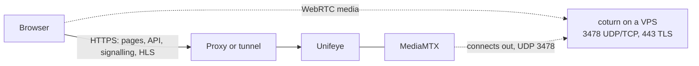

# Live video through a relay (TURN)

Live video over WebRTC normally goes straight from the Unifeye host to the browser on port 8189
([deployment.md](deployment.md#4-network)). A TURN relay is a small server elsewhere, usually a
cheap VPS, that both ends connect *out* to. The video goes through it, so:

- viewers anywhere get real-time video without port 8189 being open to the internet,
- it works behind [Cloudflare Tunnel](cloudflare-tunnel.md), which cannot carry WebRTC,
- TURN over TLS on port 443 gets through networks that only let HTTPS out.

The relay only forwards encrypted video. Who may watch what is still decided by Unifeye for every
stream, exactly as without it.



This page sets up [coturn](https://github.com/coturn/coturn) in Docker on a VPS. Hosted TURN
services (Cloudflare, Twilio) are not supported yet; see [the end of this page](#hosted-relays).

## How it works

- Unifeye and coturn share one secret (`TURN_SECRET`, coturn's `static-auth-secret`).
- When a browser starts live video, it asks Unifeye for relay logins (`GET /api/media/ice`). Unifeye
  makes them from the secret, in the format coturn checks on its own, valid for 12 hours. Only
  people who can see at least one camera get one. Browsers reuse a login for every tile until it is
  within 30 minutes of expiring.
- MediaMTX makes its own logins from the same secret and also connects out to the relay, so the
  browser and MediaMTX can meet there even when neither can reach the other.
- Unifeye checks every 30 seconds that the relay answers (a STUN request on `TURN_PORT`, UDP), and
  the server log says when that changes.
- The diagnostics window's **Video relay** row checks the relay from the viewer's own browser: it
  asks for a relay address through each of the relay's addresses (UDP, TCP and TLS) and says which
  ones work, alongside Unifeye's own check.

### Two ways to use it

| | `TURN_RELAY_ONLY` unset (default) | `TURN_RELAY_ONLY=1` |
| --- | --- | --- |
| On the office network | Direct to port 8189 on the LAN, as before | Through the relay |
| Elsewhere | Through the relay | Through the relay |
| Port 8189 | Reachable on the LAN only | Need not be reachable at all |
| Relay traffic | Off-site viewers only | Every viewer |

The default suits most sites: set `WEBRTC_PUBLIC_HOST` to the LAN IP and remove any router forward
of 8189. Use relay-only when browsers must never connect to the Unifeye host for video, even on the
LAN.

### If the relay goes down

Live video falls back to HLS through Unifeye (a few seconds behind live) and nothing else breaks.

- **Relay-only:** once Unifeye's check notices (within 30 seconds), tiles go straight to HLS
  without trying WebRTC. When the relay answers again, new tiles use it within about a minute.
- **Default mode:** MediaMTX still tries the relay for each new stream and waits for it, about
  8 seconds, before answering. Office viewers then connect directly; off-site viewers fall back to
  HLS after 4 more seconds, and their tab stays on HLS for 10 minutes.

Streams already playing through the relay drop and reconnect over HLS.

### Bandwidth

Every relayed stream enters the VPS from your site and leaves it to the viewer, so count it twice
against the VPS's traffic allowance. Your site's upload is the same as with direct WebRTC. A
camera's live stream is typically 1 to 4 Mbps, about 0.5 to 2 GB per hour of watching; wall tiles
use the lower-quality stream.

## 1. Get a VPS and a name

- Any small Linux VPS with a **public IPv4 address on its network interface** (most budget providers:
  Hetzner, DigitalOcean, Vultr, OVH). 1 vCPU and 1 GB of memory is plenty; pick one with a generous
  traffic allowance, close to where your viewers are.
- Providers that put the VPS behind NAT (AWS, Google Cloud, Azure) need `external-ip` in the coturn
  configuration below. That setup has not been tested with Unifeye.
- Docker with the Compose plugin ([docs.docker.com/engine/install](https://docs.docker.com/engine/install/)).
- A DNS name for it, such as `turn.example.com`, as an **A record** to the VPS's IP. With Cloudflare,
  make it **DNS only** (grey cloud): Cloudflare's proxy does not carry TURN.

## 2. Open the firewall

On the VPS, and in the provider's firewall if it has one:

| Port | Protocol | For |
| --- | --- | --- |
| 3478 | UDP and TCP | TURN, and Unifeye's health check (UDP) |
| 443 | TCP | TURN over TLS, for networks that only let HTTPS out |
| 49152–65535 | UDP | The relayed video itself |
| 80 | TCP | Let's Encrypt, when the certificate is issued and renewed |
| 22 | TCP | SSH, for you |

With `ufw`:

```sh
ufw allow 22/tcp && ufw allow 80/tcp && ufw allow 443/tcp
ufw allow 3478/tcp && ufw allow 3478/udp && ufw allow 49152:65535/udp
ufw enable
```

## 3. Get a certificate

TURN over TLS needs a certificate for the name. With certbot (Debian or Ubuntu):

```sh
apt install -y certbot
certbot certonly --standalone -d turn.example.com
```

coturn runs as an unprivileged user and cannot read certbot's private key, so a hook copies the
files to coturn's folder and restarts it after every renewal:

```sh
mkdir -p /opt/coturn/certs
cat > /etc/letsencrypt/renewal-hooks/deploy/coturn.sh <<'EOF'
#!/bin/sh
set -e
install -o 65534 -g 65534 -m 0644 /etc/letsencrypt/live/turn.example.com/fullchain.pem /opt/coturn/certs/fullchain.pem
install -o 65534 -g 65534 -m 0600 /etc/letsencrypt/live/turn.example.com/privkey.pem /opt/coturn/certs/privkey.pem
cd /opt/coturn && docker compose restart coturn 2>/dev/null || true
EOF
chmod +x /etc/letsencrypt/renewal-hooks/deploy/coturn.sh
/etc/letsencrypt/renewal-hooks/deploy/coturn.sh
```

certbot's timer renews the certificate on its own; `certbot renew --dry-run` checks that it will.
If you would rather not use TLS, skip this step, leave out the `tls-listening-port`, `cert` and
`pkey` lines below, and set `TURN_TLS_PORT=0` in Unifeye.

## 4. Configure coturn

Make the shared secret, and keep it for Unifeye's `.env` too:

```sh
openssl rand -hex 32
```

`/opt/coturn/turnserver.conf` (replace the name and the secret):

```ini
listening-port=3478
tls-listening-port=443
realm=turn.example.com
server-name=turn.example.com

# Logins are made by Unifeye and MediaMTX from this secret; nobody has a fixed password.
use-auth-secret
static-auth-secret=PASTE_THE_SECRET_HERE

cert=/etc/coturn/certs/fullchain.pem
pkey=/etc/coturn/certs/privkey.pem
no-tlsv1
no-tlsv1_1

min-port=49152
max-port=65535
fingerprint
no-cli
no-multicast-peers
no-tcp-relay
log-file=stdout

# Behind NAT only (AWS, Google Cloud, Azure): public IP / private IP
# external-ip=203.0.113.7/10.0.0.5

# Never relay into private or local networks: a login must not reach anything but the internet.
denied-peer-ip=0.0.0.0-0.255.255.255
denied-peer-ip=10.0.0.0-10.255.255.255
denied-peer-ip=100.64.0.0-100.127.255.255
denied-peer-ip=127.0.0.0-127.255.255.255
denied-peer-ip=169.254.0.0-169.254.255.255
denied-peer-ip=172.16.0.0-172.31.255.255
denied-peer-ip=192.0.0.0-192.0.0.255
denied-peer-ip=192.168.0.0-192.168.255.255
denied-peer-ip=198.18.0.0-198.19.255.255
denied-peer-ip=::1
denied-peer-ip=fc00::-fdff:ffff:ffff:ffff:ffff:ffff:ffff:ffff
denied-peer-ip=fe80::-febf:ffff:ffff:ffff:ffff:ffff:ffff:ffff
```

Keep STUN on (do not add `no-stun`): Unifeye's health check uses it. Then protect the file, which
holds the secret:

```sh
chown 65534:65534 /opt/coturn/turnserver.conf && chmod 600 /opt/coturn/turnserver.conf
```

`/opt/coturn/compose.yaml`:

```yaml
services:
  coturn:
    image: coturn/coturn:4.7.0
    restart: unless-stopped
    # Host networking: the relay uses thousands of UDP ports, which Docker's port mapping handles badly.
    network_mode: host
    command: ["-c", "/etc/coturn/turnserver.conf"]
    volumes:
      - ./turnserver.conf:/etc/coturn/turnserver.conf:ro
      - ./certs:/etc/coturn/certs:ro
```

Start it and check the log:

```sh
cd /opt/coturn && docker compose up -d && docker compose logs --tail 50
```

The log should list listeners on 3478 and 443 and no certificate errors. The image is allowed to
use port 443 without running as root.

If something else on the VPS already uses 443 (a web server), use `tls-listening-port=5349`, open
5349/tcp instead, and set `TURN_TLS_PORT=5349` in Unifeye. Port 443 gets through more networks,
but 5349 still covers most. If that web server already has a certificate for the relay's name (a
wildcard, say), coturn can use a copy of it: copy it with owner 65534 after each renewal, as the
certbot hook above does, and restart coturn.

## 5. Configure Unifeye

In Unifeye's `.env`:

```sh
TURN_HOST=turn.example.com          # the relay's name (or IPv4 address), no scheme or port
TURN_SECRET=...                     # the same secret as static-auth-secret
# TURN_PORT=3478                    # coturn's listening-port
# TURN_TLS_PORT=443                 # coturn's tls-listening-port; 0 if you skipped TLS
# TURN_RELAY_ONLY=1                 # see "Two ways to use it"
```

Then `docker compose up -d`. Both the app and MediaMTX are recreated: Compose passes the relay to
MediaMTX as well. If you no longer want port 8189 reachable from the internet, remove the router
forward and set `WEBRTC_PUBLIC_HOST` to the LAN IP.

## 6. Check it

1. Open Unifeye from outside the office network (a phone on mobile data works) and open the
   diagnostics window. **Video relay** should say *Reachable over UDP, TCP and TLS*. *Not over TLS*
   usually means a certificate problem. The WebRTC row should say *through the relay*, and so
   should the cameras under **Playing now**.
2. Live tiles should play within a second or two, not after the HLS delay.
3. On the VPS, `docker compose logs coturn | grep "ALLOCATE processed, success"` shows logins being
   accepted. Usernames are an expiry time and an opaque label, never a person's name.

To test the relay on its own, make a login by hand and use the
[Trickle ICE page](https://webrtc.github.io/samples/src/content/peerconnection/trickle-ice/): add
`turn:turn.example.com:3478` with the username and password below and gather candidates. A `relay`
line means the relay works.

```sh
SECRET=...   # the shared secret
u="$(( $(date +%s) + 3600 )):test"
echo "username: $u"
echo "password: $(printf %s "$u" | openssl dgst -sha1 -hmac "$SECRET" -binary | base64)"
```

## Upkeep

- Install security updates on the VPS, and update the image now and then: change the tag in
  `compose.yaml`, then `docker compose pull && docker compose up -d`.
- Changing the secret: set it in both places, restart coturn, then `docker compose up -d` in
  Unifeye. Logins already given out stop working, and those viewers reconnect.
- Watch the VPS's traffic against its allowance, especially with `TURN_RELAY_ONLY=1`.

## Hosted relays

Cloudflare Realtime TURN and Twilio are not supported yet. They give out logins through their own
API rather than from a shared secret, so Unifeye would have to ask them for a login per viewer and
hand MediaMTX one that it renews. The pieces that would change are `TurnProvider` in
`src/server/media/turn.ts` (a second implementation) and how MediaMTX gets its login (today a
fixed setting in `compose.yaml`; changing MediaMTX's relay settings while it runs restarts its
WebRTC listener and drops every WebRTC viewer, so renewals would need care).
